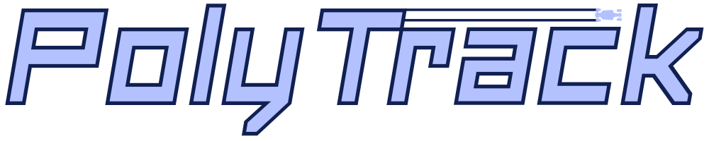

<p align="center">
  
</p>

<h1 align="center">PolyTrack — Édition bureau Windows</h1>

<p align="center">
  <a href="../../releases/latest"></a>
  
  
  
  
</p>

<p align="center">
  Application Windows autonome pour <strong>PolyTrack 0.6.0</strong> : le jeu de course low-poly
  inspiré de TrackMania, avec circuits, éditeur, garage, classements et multijoueur.
</p>

---

## Sommaire

- [À propos](#à-propos)
- [Fonctionnalités](#fonctionnalités)
- [Téléchargement et installation](#téléchargement-et-installation)
- [Lancer depuis les sources](#lancer-depuis-les-sources)
- [Compiler l'exécutable](#compiler-lexécutable)
- [Commandes](#commandes)
- [Structure du dépôt](#structure-du-dépôt)
- [Comment ça marche](#comment-ça-marche)
- [Tests](#tests)
- [Dépannage](#dépannage)
- [Contribuer](#contribuer)
- [Licence et crédits](#licence-et-crédits)

## À propos

**PolyTrack** est un jeu de course low-poly où chaque milliseconde compte :
boucles, sauts, vitesses extrêmes, circuits officiels et communautaires, éditeur
de niveaux, personnalisation de voiture et multijoueur expérimental.

Ce dépôt ne contient pas le jeu original : il ajoute une **application de bureau
Windows** autour de la version web open-source **0.6.0** de PolyTrack. Le jeu web
est embarqué dans [Electron](https://www.electronjs.org/) et servi par un petit
serveur HTTP local, afin que les Web Workers, le moteur physique WebAssembly, les
modèles 3D, l'audio et le mode en ligne fonctionnent exactement comme dans un
navigateur.

> **Ce projet n'est pas affilié à Kodub.** PolyTrack et ses ressources appartiennent
> à leurs auteurs respectifs. Lis la section [Licence et crédits](#licence-et-crédits)
> avant toute redistribution.

## Fonctionnalités

### Le jeu

- 🏁 **Campagne officielle** : circuits Summer, Winter et Desert.
- 🌍 **Circuits communautaires** inclus dans la version 0.6.0.
- 🛠️ **Éditeur de circuits** intégré, import/export de fichiers `.track`.
- 🚗 **Garage** : personnalisation de la voiture.
- 🏆 **Classements en ligne** et profils (connexion Internet requise).
- 👥 **Multijoueur expérimental** via les serveurs publics de PolyTrack.
- 🎵 Musique et effets sonores d'origine.

### L'application de bureau

- 📦 **Un seul `.exe` portable** : aucune installation, aucun navigateur.
- 🖥️ **Plein écran** (F11) et fenêtre redimensionnable ; rendu WebGL2 accéléré.
- 💾 **Sauvegardes persistantes** (réglages, records, circuits personnalisés).
- 🔊 **Audio autorisé au démarrage** (pas de blocage lié à l'autoplay).
- 🌐 **Fonctionnalités en ligne opérationnelles** (classements, profil, multijoueur).
- 🔒 **Isolation Electron** : `contextIsolation`, `sandbox`, pas d'accès Node.js
  depuis la page ; les liens externes s'ouvrent dans le navigateur.
- ⚡ **Mode développement** et **build reproductible** avec npm.

## Téléchargement et installation

1. Ouvre la page **[Releases](../../releases/latest)** du dépôt.
2. Télécharge `PolyTrack-0.6.0-portable.exe`.
3. Double-clique sur le fichier. C'est tout : aucune installation.

> **Windows SmartScreen** peut afficher « Windows a protégé votre PC », car
> l'exécutable n'est pas signé numériquement. Clique sur
> **Informations complémentaires → Exécuter quand même**.

Les données du joueur sont stockées dans :

```
%APPDATA%\PolyTrack
```

Supprimer ce dossier réinitialise complètement le jeu (records, réglages,
circuits personnalisés). Pour désinstaller l'application portable, il suffit de
supprimer le `.exe`.

## Lancer depuis les sources

Prérequis : **Windows 10/11 x64**, **Node.js 20 ou plus récent**, npm, une
connexion Internet pour le premier `npm install`.

```powershell
npm install
npm start
```

Si le binaire Electron n'a pas été téléchargé (politique de scripts npm), lance :

```powershell
node node_modules\electron\install.js
```

## Compiler l'exécutable

```powershell
npm install
npm run dist
```

Le fichier est généré dans `dist\PolyTrack-0.6.0-portable.exe`.

```powershell
# Variante : installateur classique (compression beaucoup plus longue)
npm run dist:installer
```

Détails, prérequis et dépannage de compilation : **[docs/BUILD.md](docs/BUILD.md)**.

> ⚠️ Le `.exe` fait environ **113 Mo** : il dépasse la limite GitHub de 100 Mo par
> fichier. Il ne doit **jamais** être commité dans le dépôt ; joins-le à une
> **Release** (voir [docs/RELEASE.md](docs/RELEASE.md)).

## Commandes

| Touche | Action |
| --- | --- |
| Flèches / WASD | Conduire |
| R | Réinitialiser la voiture |
| Échap | Pause / menu |
| F11 | Plein écran |
| F12 | Outils de développement |

## Structure du dépôt

```
.
├─ game/                 Jeu web PolyTrack 0.6.0 (copie intacte)
├─ main.js               Processus principal Electron
├─ server.js             Serveur HTTP local (MIME, Range, sécurité)
├─ package.json          Métadonnées + configuration electron-builder
├─ build/icon.png        Icône de l'application
├─ scripts/make-icon.js  Génère l'icône depuis le SVG du jeu
├─ test/                 Tests automatisés (smoke, gameplay, exe)
├─ docs/                 Documentation technique et FAQ
├─ .github/              Workflow de build + modèles d'issues/PR
├─ build.ps1             Script de build tout-en-un
└─ README.md
```

## Comment ça marche

Le jeu est chargé depuis `http://127.0.0.1:47821/` (port fixe). Ce choix est
volontaire :

- `file://` casserait les Web Workers, le WASM et certains `fetch` ;
- un port fixe conserve l'origine des sauvegardes `localStorage`/`IndexedDB`.

Le serveur local sert les fichiers du dossier `game/` avec les bons types MIME,
le support des requêtes `Range` (audio) et une protection contre les traversées
de répertoire. En production, les fichiers sont empaquetés dans `app.asar`, que
le serveur lit directement.

L'API officielle (`vps.kodub.com`) n'accepte que l'origine `www.kodub.com`.
L'application envoie donc cette origine pour **ce seul hôte** et renvoie l'en-tête
CORS vers l'origine locale, afin que les classements et le profil fonctionnent.
Le multijoueur (WebSocket `workers.dev`) n'a pas besoin de cette adaptation.

Explications détaillées : **[docs/ARCHITECTURE.md](docs/ARCHITECTURE.md)**.

## Tests

```powershell
# Chargement du jeu : WebGL2, menu, API, workers, réseau
npm run test:smoke

# Parcours réel : menu → circuit → course, chrono et vitesse
npm run test:gameplay

# Vérifie un .exe déjà construit (serveur, WASM, GLB, audio, circuits)
powershell -ExecutionPolicy Bypass -File .\test\verify-exe.ps1 `
  -Exe ".\dist\PolyTrack-0.6.0-portable.exe"
```

Résultats obtenus sur la version empaquetée : WebGL2 actif, ~60 FPS, course à
**129 km/h** avec chrono, 2 workers de simulation, **aucune erreur** console ou
réseau.

## Dépannage

- **SmartScreen** : voir plus haut (fichier non signé).
- **Le jeu ne démarre pas** : le port 47821 est peut-être occupé ; l'application
  essaie automatiquement les ports 47822 à 47851.
- **Pas de son** : vérifier le volume Windows et le bouton « Music » dans le jeu.
- **Réinitialiser les données** : supprimer `%APPDATA%\PolyTrack`.
- **Performances** : mettre à jour les pilotes graphiques ; Electron utilise
  l'accélération matérielle par défaut.
- **Build** : voir [docs/BUILD.md](docs/BUILD.md#dépannage).

Plus de réponses dans **[docs/FAQ.md](docs/FAQ.md)**.

## Contribuer

Les rapports de bugs, suggestions et pull requests sont bienvenus. Lis
**[CONTRIBUTING.md](CONTRIBUTING.md)** et le **[code de conduite](CODE_OF_CONDUCT.md)**
avant de commencer.

Merci de **ne pas** modifier les fichiers du jeu d'origine dans `game/` : ce
dossier est une copie de référence de la version web 0.6.0.

## Licence et crédits

- **PolyTrack original** : [Kodub](https://kodub.itch.io/polytrack) — tous droits
  réservés à ses auteurs.
- **Version web open-source 0.6.0** : [itjey/polytrack](https://github.com/itjey/polytrack).
  Ce dépôt public ne contient **aucun fichier de licence** à ce jour.
- **Application de bureau** : ce dépôt (emballage Electron, serveur local,
  outillage et documentation).

Aucune licence n'est accordée ici sur le code ou les ressources du jeu. Avant de
redistribuer publiquement le jeu ou l'exécutable, vérifie les droits auprès des
auteurs ou garde le dépôt **privé**. Le détail complet est dans
**[CREDITS.md](CREDITS.md)** et **[NOTICE.md](NOTICE.md)**.

Remerciements à Kodub, à l'auteur de la version web 0.6.0, aux créateurs des
circuits communautaires, à Maou pour le thème musical « Sci-fi Theme »
(OpenGameArt, CC-BY 4.0), ainsi qu'à Electron, electron-builder et three.js.
